# ATSker: an AI CV analyzer that scores your résumé against any job posting, and shows its work


[](https://github.com/rodrigogarcia92/ATSker/actions/workflows/deploy.yml)

**I was looking for a CV analyzer to help with my job hunt, and I couldn't find one that fit my needs. So I built one.**

The tools I tried gave me a single number with no explanation, charged per scan, kept my career data on their terms, and kept telling me to add keywords for skills I don't have. None of them handled the way I actually apply: in **Spanish and English**, to **different kinds of roles** (data science, BI, finance), with a different CV for each.

ATSker is the tool I wanted. You upload your CVs once, and it builds a master record of your career. Then you paste any job posting and get:

- a **0–100 Job Match** broken into four scores a recruiter would recognise;
- the answers to the two questions that decide most applications before a human reads them: **can an ATS read my file**, and **would a recruiter's search find me**;
- an honest list of **gaps**, including the ones that disqualify you;
- **specific edits** to make, each tied to something you actually wrote.

Every number traces to a rule, and every generated sentence traces to something you entered. ATSker never invents a skill to raise your score.

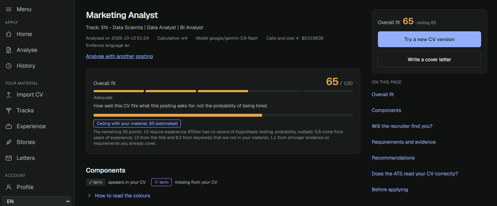

---

## At a glance

> **Problem:** commercial CV scanners are black boxes. They give one score, don't say why, and push you to add claims you can't back up.
>
> **What ATSker does:** it scores a CV against a job posting the way an ATS and a recruiter would read it. It explains every point, and it only suggests changes you can back up with your own experience.
>
> **Status:** the private app is **in production, and I use it every day** for my own applications. My family uses it too. A **free public demo** is being built (see the [Roadmap](#roadmap)).
>
> **Cost to run:** about **$0.016 per analysis** on the private app (one measured analysis, at Gemini's promotional output price). Re-analysing the same posting is free, because every model call is cached.

| Aspect | Detail |
|---|---|
| **What it is** | A full-stack web app: CV import, career database, job-fit scoring, ATS checks, writing assistance |
| **Languages** | Spanish and English, both in the interface and in the documents |
| **Score** | Job Match 0–100 = Skills 40% + Experience 25% + Title 20% + Keywords 15%, computed by plain code |
| **Where AI is used** | Only at the edges: reading documents into structured data, grading evidence, and writing text on request |
| **Prompt engineering** | Versioned prompts with strict JSON contracts, mandatory citations and a rubric that rewards saying *"none"*. All public, with [design notes](docs/prompt_design.md) |
| **Anti-fabrication** | Generated text must pass 3 validators: it cites its source, keeps every number and name from that source, and names only skills you have |
| **Evaluation** | Rank agreement with labelled CV/posting pairs (Kendall τ-b 0.65 on the dev split), plus an ablation of each score |
| **Quality** | About 1,250 offline tests (no network, no Postgres) and lint on every push |

### Tech stack

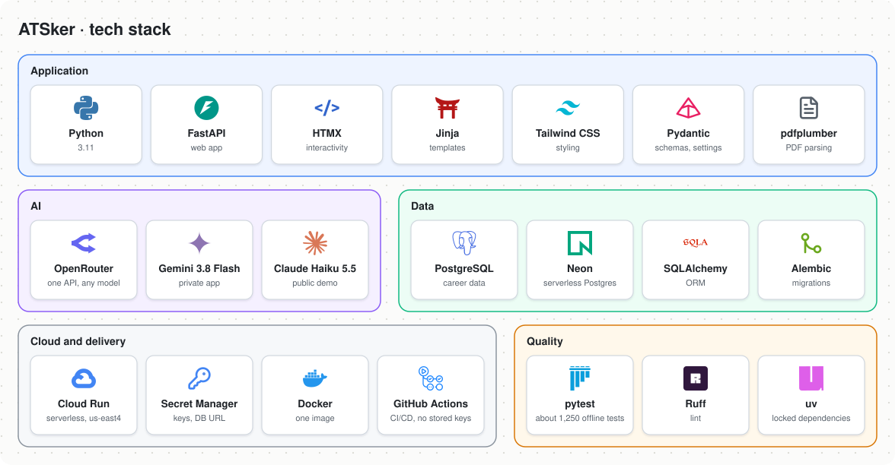

---

## Roadmap

| Feature | Status |
|---|---|
| **Private app**: import, career database, tracks, analysis report, recommendations, CV testing, cover letters, Spanish and English | ✅ **Live**, in daily use |
| **Public demo**: no sign-up, a free session in one click, data deleted 24 hours after you start, your CV file never stored, running on Claude Haiku 5.5 | 🚧 **In progress**: not live yet |
| First-steps guide for new users (welcome screen, checklist, empty states that teach) | 📅 Planned |
| **Potential**: what your CV could say using material you already have, with the projected score | 📅 Planned |
| A larger labelled evaluation set (n ≥ 20), with a sealed test split | 📅 Planned |
| Outcome tracking: does a higher Job Match actually lead to more interviews? | 📅 Planned |

---

## Contents
1. [Why I built it](#1-why-i-built-it)
2. [A tour of the app](#2-a-tour-of-the-app)
3. [How the score works](#3-how-the-score-works)
4. [Honest by design](#4-honest-by-design)
5. [Prompt engineering](#5-prompt-engineering)
6. [Architecture](#6-architecture)
7. [Evaluation and model selection](#7-evaluation-and-model-selection)
8. [Privacy](#8-privacy)
9. [Limitations](#9-limitations)

---

## 1. Why I built it

| What I needed | What I found |
|---|---|
| To know **why** a CV scores what it does | One number, no breakdown |
| To know if an ATS can even **read** my file | Nothing, or a generic "use a simple template" |
| To know if a recruiter's **search** would return me | Nothing |
| Advice I could act on **honestly** | "Add these 12 keywords", including tools I have never used |
| Spanish **and** English, and a CV per kind of role | English only, one CV at a time |
| To test the **actual file** I'm about to send | Scores for a form, not for my document |
| My data on my terms, and no fee per scan | Subscriptions, credits, data on someone else's servers |

So I set one rule for every feature: **a higher score is never a reason to add a claim**. ATSker shows the evidence you already have and puts what you lack in the gap list. It never puts a missing skill into your CV.

---

## 2. A tour of the app

### Import once, reuse everywhere
Upload a CV (PDF or Word, Spanish or English). ATSker first checks whether an ATS can read it, then extracts your roles, bullets, education, certifications and skills into a review screen. Nothing is saved until you confirm. A second CV is merged, not overwritten: each item is marked *new*, *changed* or *unchanged*.

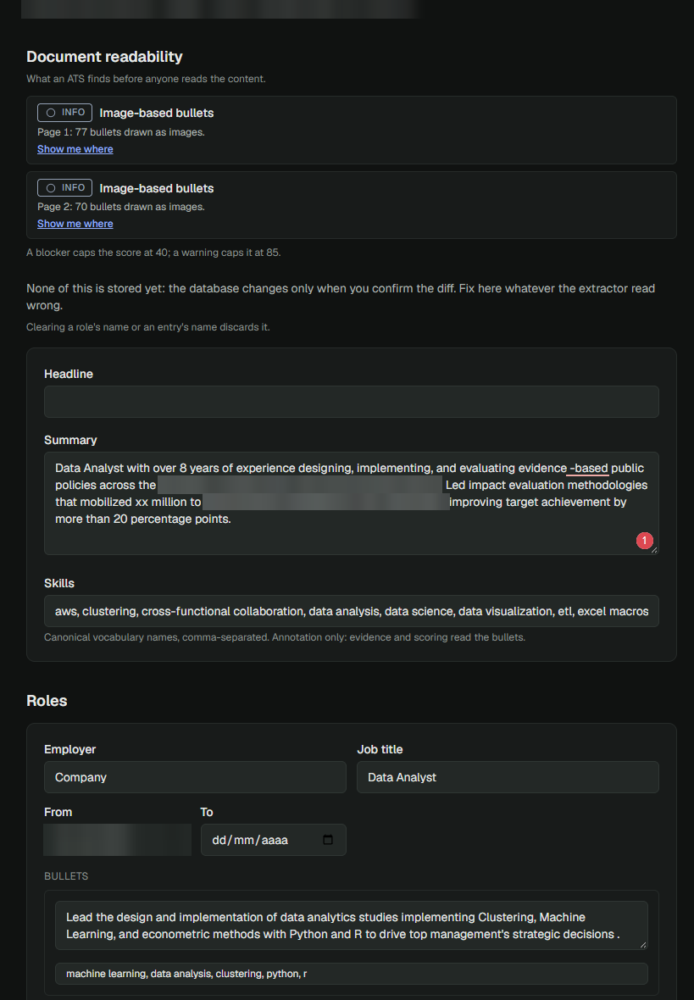

### Tracks: one career, several target roles
A **track** is a saved selection of your bullets, skills, summary and headline for one kind of role, such as *Data Scientist*, *BI Analyst* or *Financial Analyst*. Tracks reference the master record instead of copying it, so fixing a bullet fixes it everywhere. If you don't pick a track, ATSker grades all of them and recommends one.

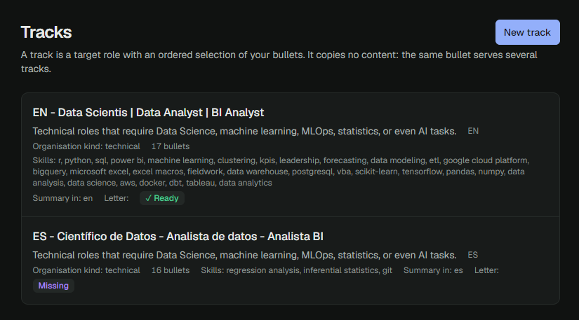

### The report
Paste a job posting and get one page that reads top to bottom in the order you'd ask the questions:

- **Job Match** and its four components, each with the terms it found and the ones it missed;
- **the ceiling**: the best score your own material could reach for this posting, so you know when to stop editing;
- **Would a recruiter find you?** The boolean searches a recruiter would plausibly run, written out so you can copy them, with *you appear / you don't*;
- **Requirements and evidence**: every requirement graded 0–3, with the bullet that proves it;
- **Recommendations**: which bullets to move up, which to add, and a **keywords card** saying where each missing keyword could go *if it is true*;
- **Can the ATS read your CV?**, with "show me where" for each problem it finds;
- **Before you apply**: deal-breaking gaps, warnings, and the claims you should prepare to defend.

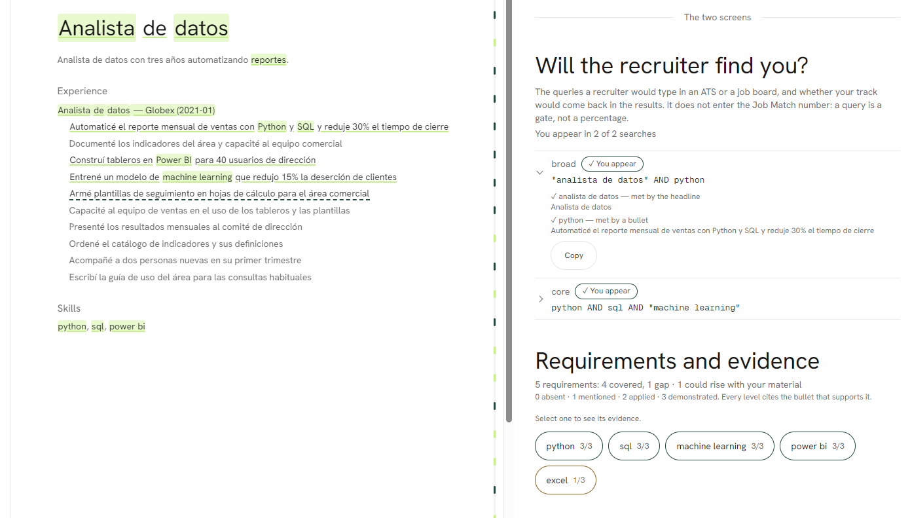

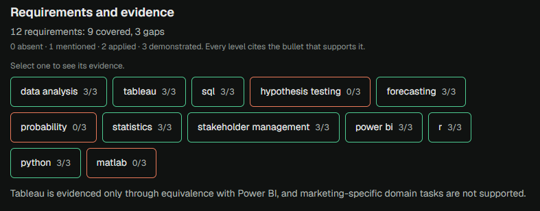

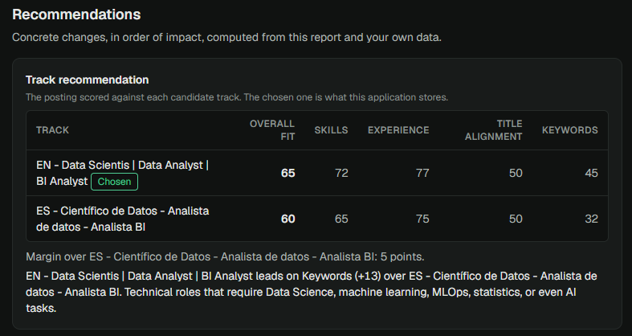

### Test the file you will actually send
After editing your Word document for this posting, upload it. ATSker scores **that file** against the same posting and compares it to your ceiling. It also flags anything new in the document that isn't in your records, such as a number, a tool or a title. When the CV is as good as your material allows, it says so: *"CV optimised: what's left is experience ATSker has no record of."*

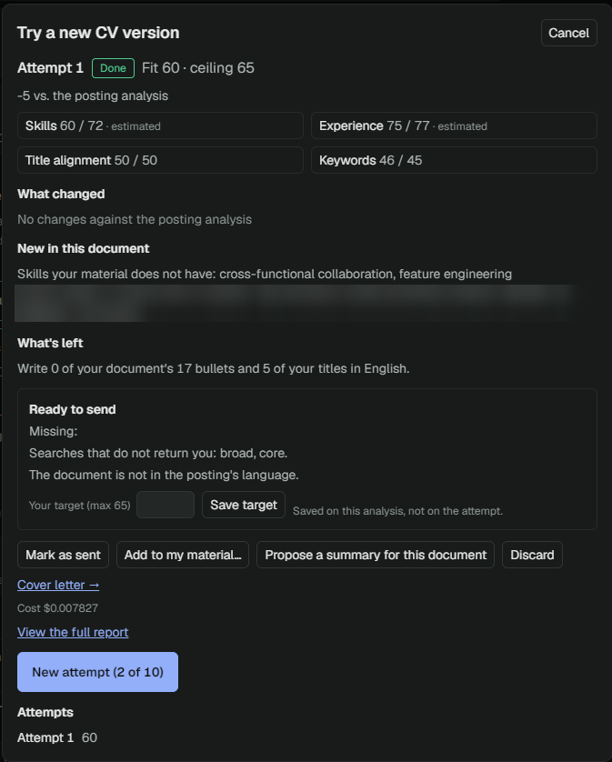

### Writing help that can't make things up
A tailored **summary**, a **cover letter** paragraph, a rephrased bullet: each one is a proposal you review and edit. Before you see it, each passes three validators. A list of AI clichés (*"I am excited to"*, *"leverage"*, *"me apasiona"*) is checked by code, not just requested.

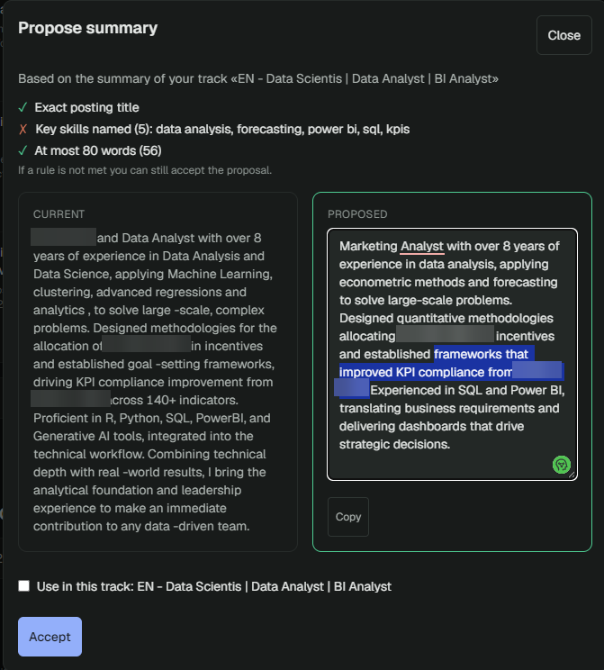

### Built for the phone too
The whole flow works on a phone, including uploading a CV.

<p align="center">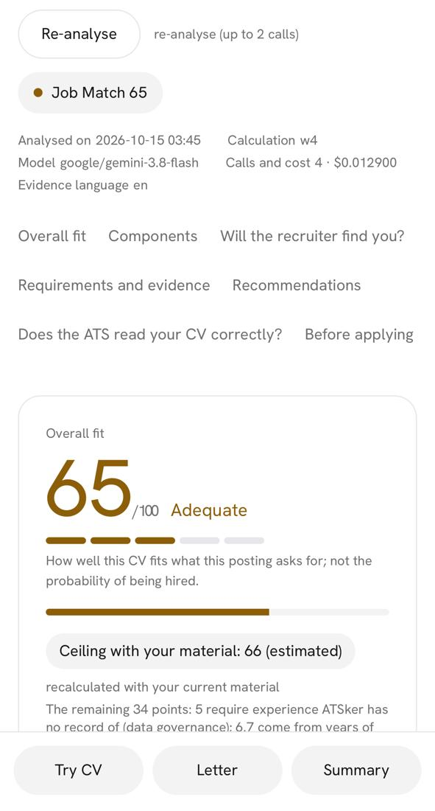</p>

---

## 3. How the score works

**Job Match** (0–100) is a weighted sum of four scores, all computed by ordinary code:

| Score | Weight | What it measures |
|---|---|---|
| **Skills** | 40% | Each requirement graded 0–3 from your evidence. Credit is full for a direct match, 75% for an equivalent tool (Tableau ↔ Power BI), 50% for a transferable skill. Shown split into *direct* and *transfer*, so you see how much depends on an argument |
| **Experience** | 25% | The years a recruiter would actually count for this posting, plus how many of its core tasks you've already done |
| **Title** | 20% | Your headline and role titles against the posting's title, in the posting's language |
| **Keywords** | 15% | The posting's own terms found in your document, spelling variants included, equivalents not (a real ATS filter doesn't know Tableau and Power BI do the same job) |

Two checks sit **beside** the number, never inside it, because a deal-breaker is not a percentage:

- **Readability (the ATS parse gate).** Plain code reads your PDF's layout and finds hidden text, contact details in the header or footer, text inside tables, multi-column layouts, broken characters and unembedded fonts. A **blocker caps the score at 40** and a warning at 85. The uncapped score is always shown, so you can see what fixing the layout would earn.
- **Recruiter search recall.** The model writes the boolean searches a recruiter would run, and code checks whether your track matches each one. Pass or fail, with the missing term named.

---

## 4. Honest by design

- **The model only works at the edges.** It turns unstructured text into structured data, grades evidence, and writes prose when you ask. Everything in between, from normalisation to scoring, search, gaps and advice, is deterministic and runs offline in tests.
- **Every grade cites its evidence.** A requirement graded above zero must point to one of your bullets. An answer citing an id it wasn't given fails, is retried once, then fails loudly.
- **Generated text passes three validators** before you see it:
  1. **Provenance:** it cites a stored bullet, story or summary;
  2. **Literal preservation:** every number, date and proper noun is in that source;
  3. **Skill closure:** every skill it names is one you have.
- **Probable is labelled as probable.** When the keywords card suggests a skill you likely have, it says *"Probable — only if true"*, shows its reason, and never changes your score.
- **Every analysis records** its score version, prompt versions, model, tokens, cost and latency, so a changed score can always be explained.

---

## 5. Prompt engineering

The model does four jobs in ATSker: reading documents into structured data, grading evidence, explaining gaps that code already found, and writing text on request. Each job has its own prompt, and **every prompt is public**, in [`src/extract/prompts.py`](src/extract/prompts.py). The reasoning behind them is in [`docs/prompt_design.md`](docs/prompt_design.md).

**The prompt asks, and code enforces.** Each prompt is written so the honest answer is the easy one. Code then checks every answer without trusting the prompt.

- **Contracts, not conversations.** Every call returns strict JSON against a schema generated from the same Pydantic model the code parses it with. Temperature is always 0.
- **Cite or don't claim.** The model sees each bullet with an id and must cite one for any grade above zero. An id it wasn't given is rejected, retried once, then fails loudly.
- **Make "none" a good answer.** The grading rubric says: *"an unsupported requirement is level 0, which is a normal and useful answer."* Models fill silence, so abstaining is framed as success.
- **Judgement in the prompt, arithmetic in code.** The model grades evidence 0–3 and labels it *direct*, *equivalent* or *transferable*, using a three-question domain test. It never computes a score.
- **Stable rules, variable data.** The rules sit in the system message, which is cached across postings at a fraction of the price. Only the data changes.
- **Versioned like code.** A changed prompt gets a new version string, which busts the cache on purpose, so answers from different rules are never mixed. Old versions stay in the file, because saved reports name the prompt that produced them.

Prompts are refined against real output. The summary generator went through five versions; the last three show how:

| Version | What changed |
|---|---|
| v3 | The summary alone; the skills list moved to its own Keywords card |
| v4 | Three ordered rules: open with the posting's exact title, name 3–4 skills from a shortlist chosen by code, and improve the user's own summary without adding facts |
| v5 | Cite the bullet behind each skill named, and drop old-summary skills the posting doesn't ask for |

```text
For any level above 0 you must say where the evidence is: the source (bullet,
summary or skills_list) and, for a bullet, the id of the bullet that supports it.
Never cite an id you were not given, and never assume experience the CV does not
show: an unsupported requirement is level 0, which is a normal and useful answer.
                                        (evidence_grade_v4, from src/extract/prompts.py)
```

---

## 6. Architecture

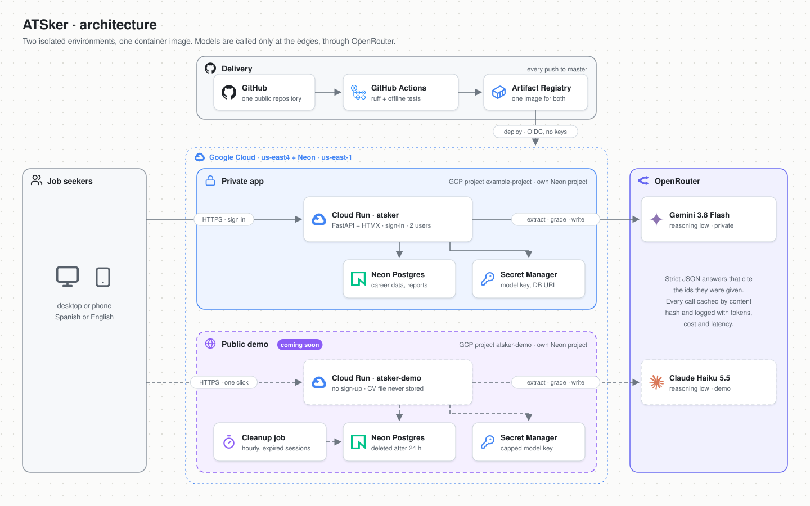

- **One codebase, two deployments.** The private app and the public demo are the same container image. They differ only in configuration: model, login, data retention and spend limits. Each has its own Google Cloud project, database and model key, so the demo can't reach private data.
- **Serverless and nearly free.** Cloud Run scales to zero, and Neon Postgres suspends when idle. The database connection is pool-free on purpose, because a kept-alive connection would keep a scale-to-zero database awake.
- **No local Docker, no stored cloud keys.** GitHub Actions lints, tests, builds and deploys, authenticating to Google Cloud through Workload Identity Federation.

Module boundaries keep the deterministic core testable:

```
src/
├── parse/       PDF and DOCX geometry, the readability gate   may not import extract/
├── extract/     the only module that calls a model
├── normalize/   text → comparable tokens, Spanish and English
├── search/      recruiter-search evaluation                    no network
├── score/       sub-scores, Job Match, ceiling                 no network
├── generate/    proposals, cover letters, validators
├── web/         FastAPI routes, HTMX partials, templates
└── i18n/        every interface string in both languages
```

---

## 7. Evaluation and model selection

**Agreement, not absolute accuracy.** Scores are judged by whether they **rank** CV/posting pairs the way a careful reader would. On the development split (n = 12 pairs, 2,000 bootstrap resamples):

| Metric | Value | 95% interval |
|---|---|---|
| Kendall τ-b | 0.646 | [0.223, 0.948] |
| Spearman ρ | 0.747 | [0.254, 0.978] |

**Ablation** (τ-b with each score dropped): dropping Experience (0.497) or Title (0.593) lowers agreement; dropping Skills or Keywords (0.657 each) does not, at this sample size. Those two will be re-measured as the set grows.

**The model is chosen by experiment, not preference.** Candidates are compared on agreement, stability across repeated runs, invented citations, cost and latency. In the latest latency benchmark (posting extraction plus evidence grading, median of 3 runs):

| Model (OpenRouter, low reasoning) | Time | Cost per analysis | Invented citations | Used for |
|---|---|---|---|---|
| Gemini 3.5 Flash-Lite | 17.1 s | $0.0057 | 0 | — |
| Gemini 3.8 Flash | 22.3 s | $0.0100 | 0 | **private app** |
| Claude Haiku 5.5 | 25.7 s | $0.0026 | 0 | **public demo** (in progress) |

*Haiku row: measured on the generalised (strict) CV, where 3 of 3 runs succeeded. On the standard CV only 1 of 3 succeeded (2 connection resets).*

Earlier rounds ruled out models that timed out or cited bullets that didn't exist. The full record is in [`docs/methodology.md`](docs/methodology.md).

---

## 8. Privacy

- **No personal data in this repository, except what I chose to show.** Tests use synthetic fixtures, and real CVs and reports never enter git. The screenshots in this README come from my own analysis, shared on purpose: names and employers are blurred wherever they appear, and no contact details are shown.
- **Names, e-mails and phone numbers are removed** before any text is sent to a model provider.
- **Logs hold hashes and ids only.** They never contain CV text, stories or job postings.
- **Delete means delete.** Any item, or everything, can be permanently removed from the interface, including the model answers that quoted it.
- **The public demo will keep less:** your CV file is read in memory and never stored, and everything extracted from it is deleted 24 hours after your session starts.

---

## 9. Limitations

- **Small evaluation set.** n = 12 on the development split, so the intervals are wide. Trust the ranking more than any single value.
- **The automatic rater shares the grader's definition of transferable skills**, so its agreement is not proof that recruiters agree. The real test is outcome tracking ([Roadmap](#roadmap)).
- **Title is sensitive to language.** A Spanish title against an English posting scores lower, on purpose: an ATS matches the words you send. ATSker tells you when this happens.
- **Recruiter search is checked against your track's text.** Recruiters search profiles on platforms like LinkedIn, so this is a proxy.
- **Job Match measures fit, not your chance of being hired.**

---


## Acknowledgements

**Author:** Rodrigo García Sánchez: product idea, specification, scoring and evaluation design, and final judgment on every change.

**AI assistance:** this project was developed with [Claude](https://www.anthropic.com/claude) (Anthropic) as an AI assistant. It was used for code implementation (through Claude Code), design and code review, analysis support and documentation drafting. Every change was reviewed and accepted by the author. The public demo, in progress, will run on Claude Haiku 5.5.

---

**Licence:** none. The code is public to read and learn from; all rights are reserved.

*Portfolio project by Rodrigo García Sánchez. ATSker is not affiliated with any ATS vendor, job board or recruiter. Job Match estimates fit to a posting; it is not a prediction of being hired.*
